<div align="center">


<br/>


### 🚗 Car Dealership Management System
**Zero-contact vehicle sales, bookings & service tracking — built with Node.js, Express & MongoDB**

<a href="https://git.io/typing-svg"></a>

<br/>


[](https://github.com/Syed-Muhammad-Tayyab)

[✨ Features](#-features) • [📸 Screenshots](#-screenshots) • [🧰 Tech Stack](#-tech-stack) • [🗂️ Structure](#️-project-structure) • [⚡ Quick Start](#-quick-start) • [🛣️ Routes](#️-routes) • [🗄️ Database](#️-database-schema) • [🤝 Contributing](#-contributing)

</div>

---

## 📌 About The Project

**Autorizz** is a web-based digital retail platform for automotive dealerships. It lets customers browse **electric** and **gas** vehicles, filter by specs, view full details and **book a car online** — while the dealership manages everything (models, customers, service jobs, images) from a dedicated **admin panel**.

> 💡 Replace slow manual records and file systems with one fast, centralized system — customers shop from the comfort of home, dealers save time and cost.

<div align="center">

| 🙍 Customers | 🛡️ Admin / Dealer |
|:--|:--|
| Browse & filter vehicles | Add / delete Electric & Gas models |
| Full specs, safety & tech details | Manage customer leads |
| Book a car online | Track vehicle service jobs |
| Fully mobile responsive | Email customers when service is done |

</div>

---

## ✨ Features

<table>
<tr>
<td width="50%">

### 🙍 Client Side
- ⚡ Electric & Gas vehicle catalogues
- 🔎 Advanced filtering (price, year, specs…)
- 📄 Detailed vehicle pages — range, top speed, 0-60, engine, safety, technology
- 📝 Online booking form (name, email, phone)
- 🎬 Rich landing page with video & visuals
- 📱 Fully responsive on mobile

</td>
<td width="50%">

### 🛡️ Admin Side
- 🔐 Admin login
- ➕ Add / 🗑️ delete Electric models
- ➕ Add / 🗑️ delete Gas models
- 🖼️ Upload vehicle images (Multer)
- 👥 Customer management
- 🧰 Service tracking with bill & status
- 📧 One-click "service completed" email (Nodemailer)

</td>
</tr>
</table>

---

## 📸 Screenshots

### 🙍 Client End

<div align="center">

**🏠 Home**
<br/>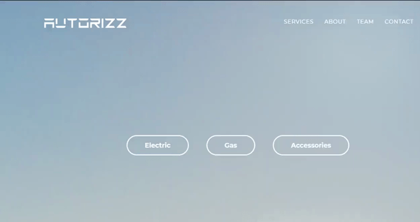

**⚡ Electric Models & Filters**
<br/>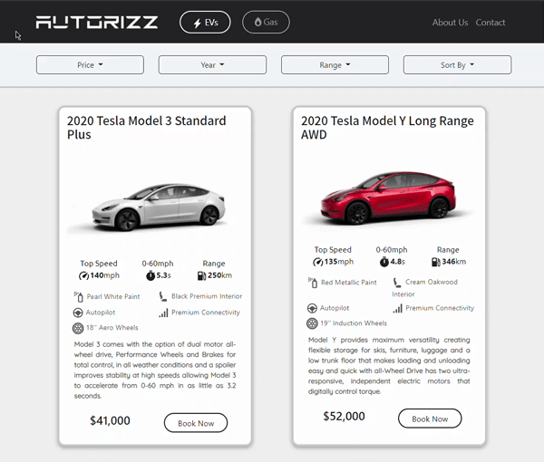
<br/>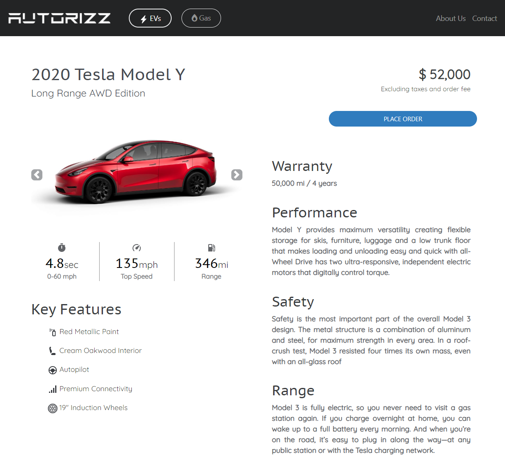

**⛽ Gas Models & Filters**
<br/>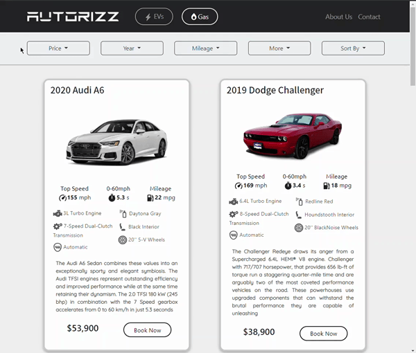
<br/>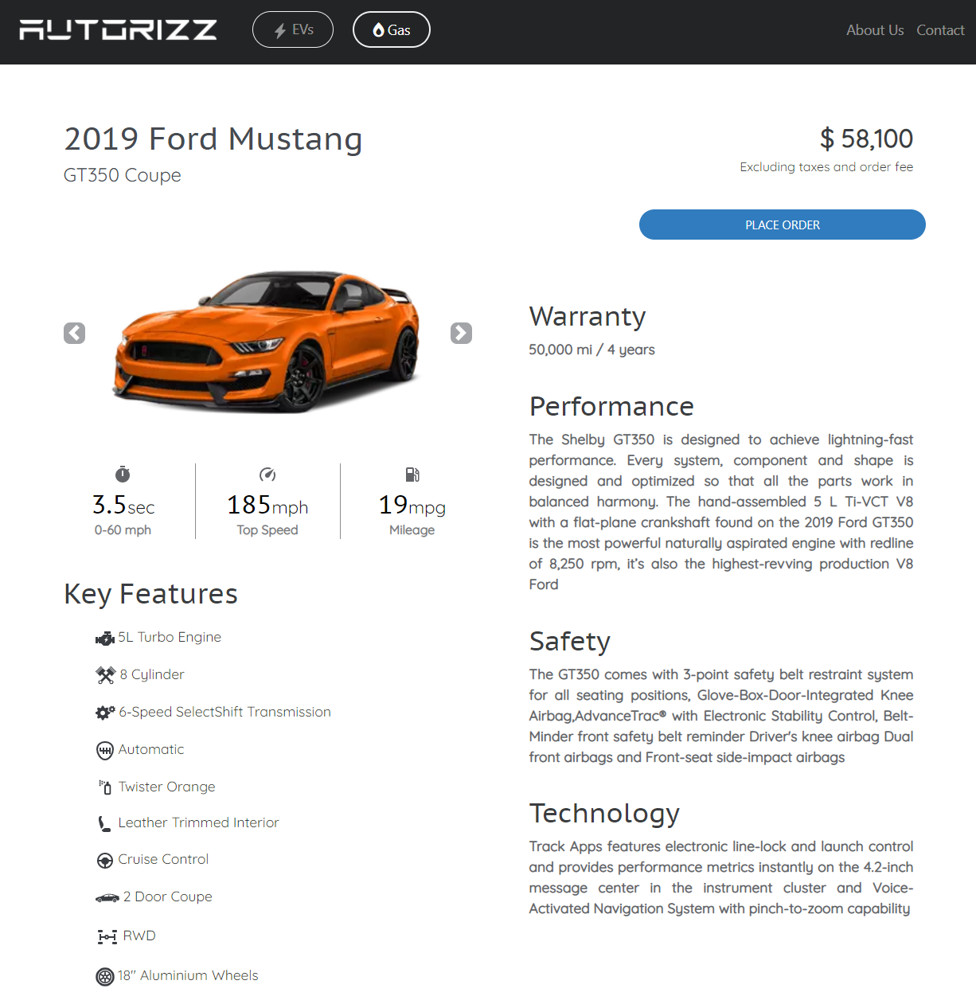

</div>

### 📱 Mobile Responsive

<div align="center">

**Electric**
<br/>
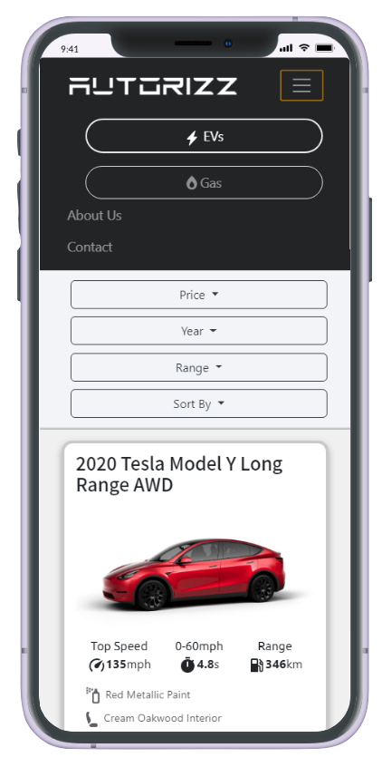
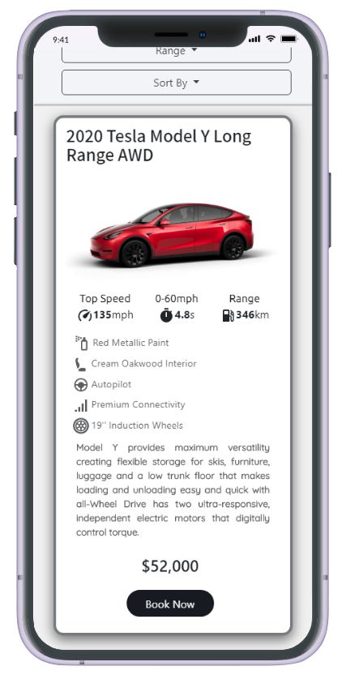
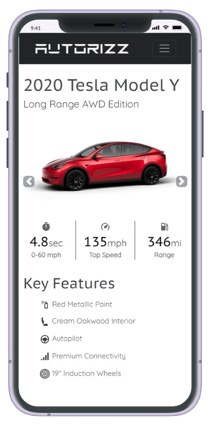
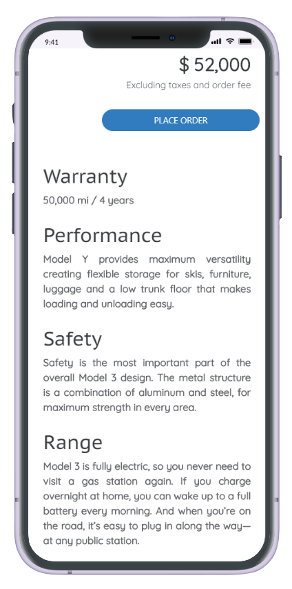

**Gas**
<br/>
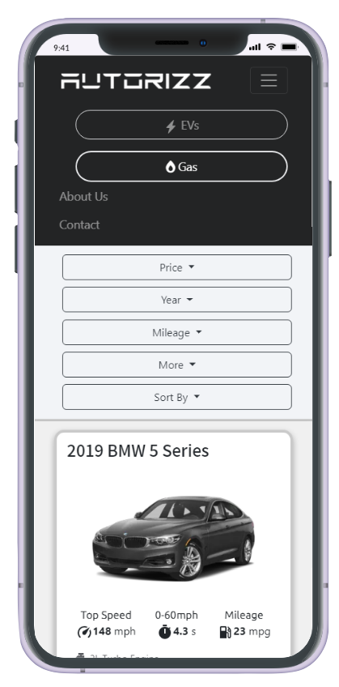
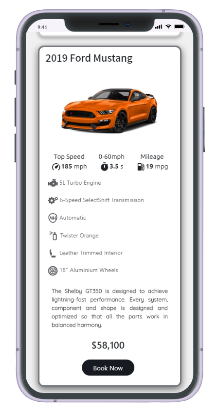
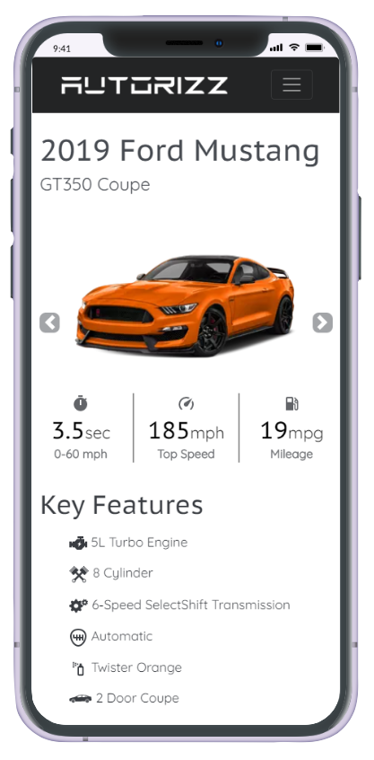
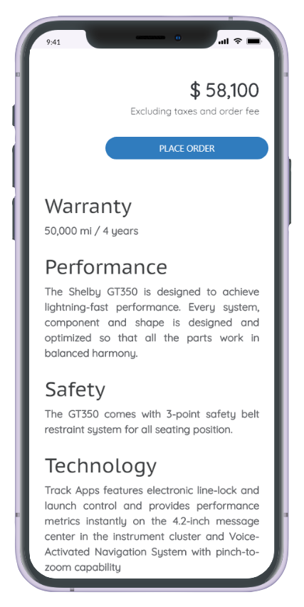

</div>

### 🛡️ Admin End

<div align="center">

| 🔐 Login | 🏠 Dashboard |
|:--:|:--:|
| 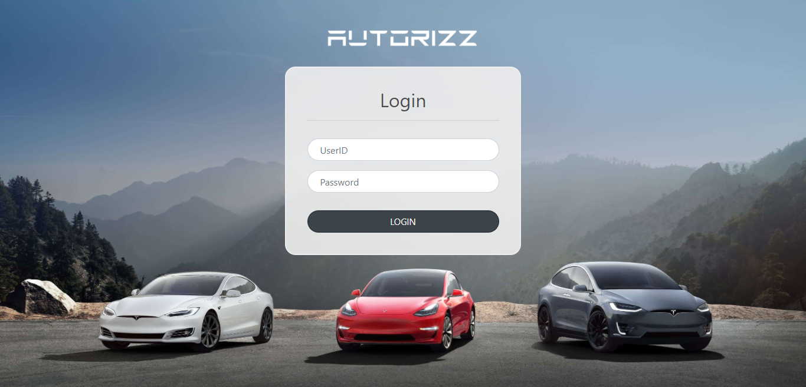 | 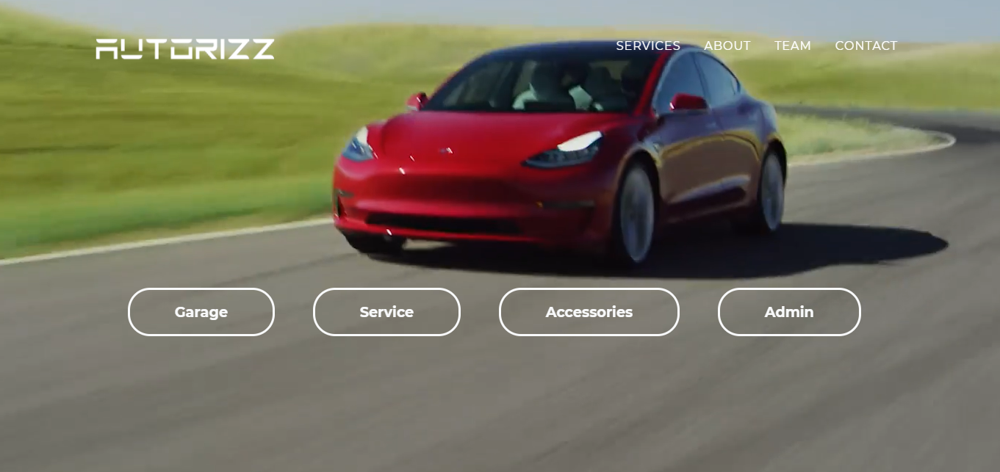 |

| 🧰 Service | 🚘 Models | 👥 Customers |
|:--:|:--:|:--:|
| 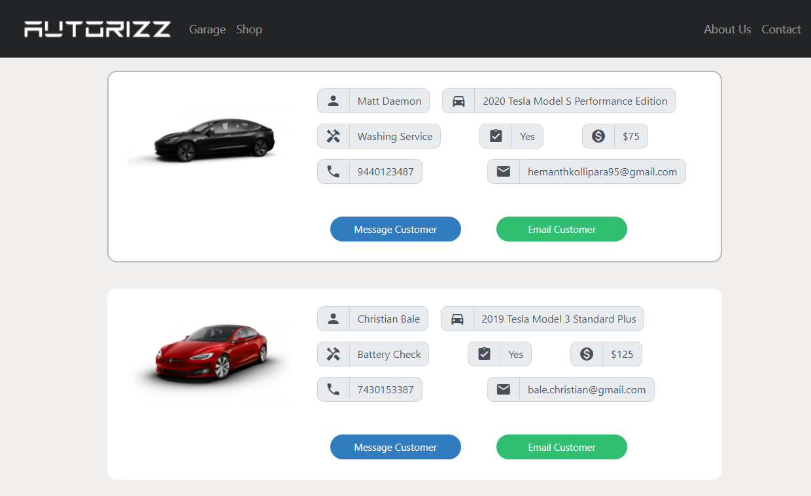 | 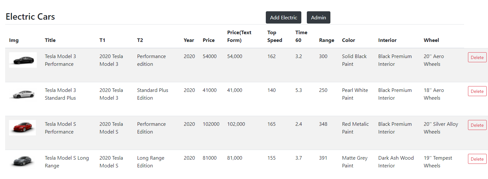 | 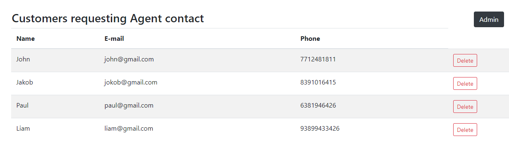 |

</div>

---

## 🧰 Tech Stack

<div align="center">


| Layer | Technology |
|:--|:--|
| **Runtime** | Node.js |
| **Framework** | Express.js 4 |
| **Database** | MongoDB + Mongoose 5 |
| **Templating** | Handlebars (`express-handlebars`, `hbs`) |
| **Uploads** | Multer |
| **Email** | Nodemailer (Gmail) |
| **Performance** | compression, morgan logging |
| **Config** | dotenv |
| **Frontend** | HTML5, CSS3, Bootstrap, Vanilla JS |

</div>

---

## 🗂️ Project Structure

```bash
Autorizz-Car-Dealership-System/
│
├── 📁 .github/
│   └── ISSUE_TEMPLATE/
│       └── bug_report.md
│
├── 📁 bin/
│   └── www                    # Server entry point (HTTP server, PORT)
│
├── 📁 db_data/                # 🌱 Seed data (import into MongoDB)
│   ├── user.json              #   admin login
│   ├── electricmodel.json     #   electric vehicles
│   ├── gasmodel.json          #   gas vehicles
│   ├── customer.json          #   customers
│   └── service.json           #   service jobs
│
├── 📁 docs/                   # 🖼️ README screenshots & GIFs
│   ├── assets/
│   └── mobile/
│
├── 📁 models/                 # 🗄️ Mongoose schemas
│   ├── ElectricModel.js
│   ├── GasModel.js
│   ├── CustomerModel.js
│   ├── ServiceModel.js
│   └── UserModel.js
│
├── 📁 public/                 # 🎨 Static assets
│   ├── css/                   #   style, home, login, admin, booking…
│   ├── images/                #   vehicle & UI images, tesla.mp4
│   └── javascripts/           #   ev_cars.js, gas_cars.js (client logic)
│
├── 📁 routes/                 # 🛣️ Express routers
│   ├── admin.js               #   admin panel + CRUD + email
│   ├── electric_index.js      #   electric catalogue, filter, booking
│   ├── gas_index.js           #   gas catalogue, filter, booking
│   ├── home.html              #   landing page
│   ├── login.html             #   admin login page
│   ├── loginerror.html
│   └── admin_home.html
│
├── 📁 utils/
│   └── mailer.js              # 📧 Nodemailer helper
│
├── 📁 views/                  # 🧩 Handlebars templates
│   ├── admin/                 #   admin_index, lists, forms, service…
│   ├── layouts/               #   layout.hbs, layout_list.hbs
│   ├── electric_index.hbs
│   ├── gas_index.hbs
│   ├── booking.hbs
│   ├── gasbooking.hbs
│   └── error.hbs
│
├── 📄 app.js                  # Express app, DB connection, routing
├── 📄 package.json
├── 📄 .env.example            # Environment variables template
├── 📄 .gitignore
├── 📄 CONTRIBUTING.md
├── 📄 LICENSE
└── 📄 README.md
```

---

## ⚡ Quick Start

### ✅ Prerequisites

- [Node.js](https://nodejs.org/) **v14.15.1+**
- [MongoDB](https://www.mongodb.com/try/download/community) running locally (or a MongoDB Atlas URI)
- `mongoimport` (included in MongoDB Database Tools)

### 🚀 Installation

```bash
# 1️⃣ Clone the repository
git clone https://github.com/Syed-Muhammad-Tayyab/Autorizz-Car-Dealership-System.git
cd Autorizz-Car-Dealership-System

# 2️⃣ Install dependencies
npm install

# 3️⃣ Create your environment file
cp .env.example .env
#   then edit .env with your values

# 4️⃣ Import seed data (database: autorizz)
mongoimport --db autorizz --collection user          --file db_data/user.json          --jsonArray
mongoimport --db autorizz --collection electricmodel --file db_data/electricmodel.json --jsonArray
mongoimport --db autorizz --collection gasmodel      --file db_data/gasmodel.json      --jsonArray
mongoimport --db autorizz --collection customer      --file db_data/customer.json      --jsonArray
mongoimport --db autorizz --collection service       --file db_data/service.json       --jsonArray

# 5️⃣ Start the app
npm start          # production
npm run dev        # development (nodemon)
```

🌐 Open **http://localhost:5000**

### 🔑 Environment Variables

| Variable | Description | Default |
|:--|:--|:--|
| `PORT` | Server port | `5000` |
| `MONGODB_URI` | MongoDB connection string | `mongodb://localhost:27017/autorizz` |
| `MAIL_USER` | Gmail address used to send service emails | — |
| `MAIL_PASS` | Gmail **app password** | — |

### 🧪 Default Admin (demo seed)

| URL | User | Password |
|:--|:--|:--|
| `/admin` | `admin` | `admin` |

> ⚠️ **Change this before any real deployment.** The seed stores the password in plain text — see [Roadmap](#️-roadmap).

---

## 🛣️ Routes

<details>
<summary><b>🙍 Client routes</b></summary>

| Method | Route | Description |
|:--:|:--|:--|
| GET | `/home` | Landing page |
| GET | `/electric` | Electric catalogue |
| GET | `/electric/filter` | Filter electric models |
| GET | `/electric/booknow/:id` | Book an electric model |
| GET | `/gas` | Gas catalogue |
| GET | `/gas/filter` | Filter gas models |
| GET | `/gas/booknow/:id` | Book a gas model |
| POST | `/customer` | Save customer lead |

</details>

<details>
<summary><b>🛡️ Admin routes</b></summary>

| Method | Route | Description |
|:--:|:--|:--|
| GET | `/admin` | Admin login page |
| POST | `/admin/login` | Authenticate admin |
| GET | `/admin/home` | Admin dashboard |
| GET | `/admin/electric` · `/admin/gas` | List models |
| GET/POST | `/admin/addelectric` · `/admin/addgas` | Add model |
| GET | `/admin/deleteelectric/:id` · `/admin/deletegas/:id` | Delete model |
| GET | `/admin/customers` | List customers |
| GET | `/admin/deletecustomer/:id` | Delete customer |
| GET | `/admin/service` | Service jobs |
| GET | `/admin/service/email/:mailid` | Email "service completed" |
| GET | `/admin/images` | Image upload page |
| POST | `/admin/uploadimage` | Upload image |

</details>

---

## 🗄️ Database Schema

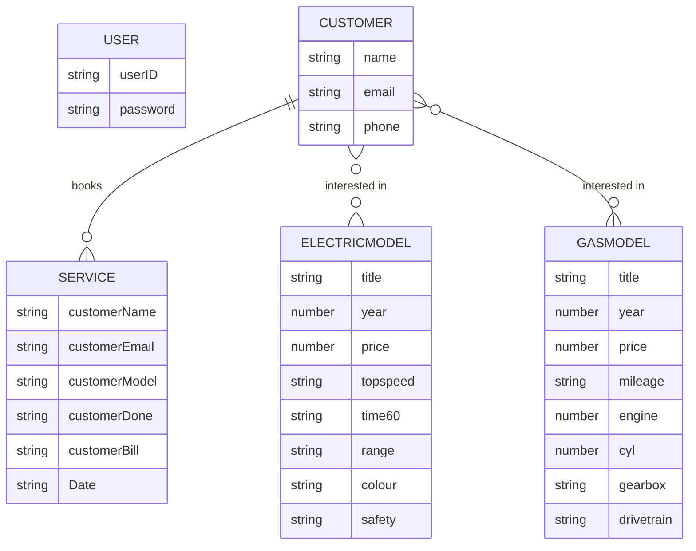

---

## 🗺️ Roadmap

- [x] Electric & Gas catalogues with filtering
- [x] Online booking
- [x] Admin CRUD for models & customers
- [x] Service tracking with email notification
- [x] Environment-variable configuration
- [ ] 🔐 Hash passwords (bcrypt) & session / JWT auth
- [ ] 🛡️ Protect admin routes with middleware
- [ ] 🔁 Convert delete routes from GET to DELETE/POST
- [ ] 💳 Online payment integration
- [ ] 📊 Admin analytics dashboard
- [ ] 🐳 Docker support

---

## 🤝 Contributing

Contributions, issues and feature requests are welcome! Read [CONTRIBUTING.md](CONTRIBUTING.md), then:

```bash
git checkout -b feature/amazing-feature
git commit -m "feat: add amazing feature"
git push origin feature/amazing-feature
```

Open a Pull Request 🎉

---

## 📜 License

Distributed under the **MIT License**. See [`LICENSE`](LICENSE) for details.

## 🙏 Credits

Based on the open-source project *Autorizz Car Dealership System* by [Hemanth Kollipara](https://github.com/Defcon27/Autorizz-Car-Dealership-System-using-NodeJS-Express-MongoDB) (MIT). This version is maintained and extended by **Syed Muhammad Tayyab**.

---

<div align="center">

### 👨‍💻 Developed by **Syed Muhammad Tayyab**

[](https://github.com/Syed-Muhammad-Tayyab)

⭐ **If you like this project, give it a star!** ⭐


</div>
